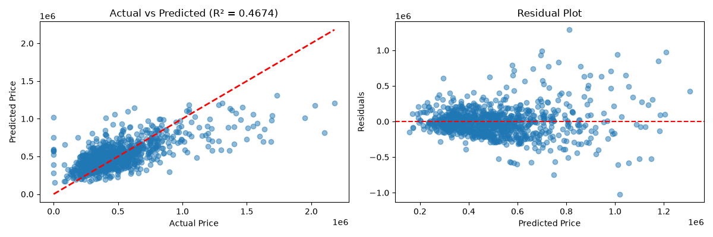

# House Price Estimation

This project builds a machine learning model to estimate home prices based on housing features such as square footage, number of bedrooms, bathrooms, property age, and location-related attributes.

## Dataset

Take the dataset from the Kaggle link below:

https://www.kaggle.com/datasets/shree1992/housedata/data

The dataset used in this project is the House Sales dataset from Kaggle. The file is named `data.csv` in this project folder.

The dataset contains property information such as:
- price
- bedrooms
- bathrooms
- sqft_living
- sqft_lot
- floors
- waterfront
- view
- condition
- city / state / country metadata
- year built / year renovated

## Project Objective

The goal is to:
- clean and preprocess the real estate dataset
- engineer useful features like house age
- train a regression model to predict prices
- evaluate the model using metrics like MAE, RMSE, and R²
- visualize prediction quality with a scatter plot and residual plot

## Model Summary

A Linear Regression model is used with feature scaling and train/test splitting for prediction.

## Project Structure

- `data.csv` - housing dataset
- `house_price_model.py` - training and evaluation script
- `model_results.png` - model performance visualization
- `README.md` - project documentation

## Requirements

Install the required Python libraries with:

```bash
pip install pandas numpy matplotlib seaborn scikit-learn
```

## How to Run

From the project folder, run:

```bash
python house_price_model.py
```

This script will:
1. load the dataset
2. clean and transform the data
3. train the model
4. print evaluation metrics
5. save the result plot as `model_results.png`

## Model Results

The following model evaluation results were obtained from the project dataset after preprocessing and training with Linear Regression.

| Metric | Train | Test |
| --- | ---: | ---: |
| R² | 0.4426 | 0.4674 |
| MAE | $153,096.38 | $149,893.24 |
| RMSE | $219,062.40 | $213,954.24 |



## Notes

- The dataset loads successfully and contains 4,600 rows and 18 columns.
- The script is designed for a local desktop environment and uses `matplotlib` plots for interactive result viewing.
- If you run the script in a headless environment, you may want to disable or comment out `plt.show()` to avoid blocking execution.

## Author

House Price Estimation Project